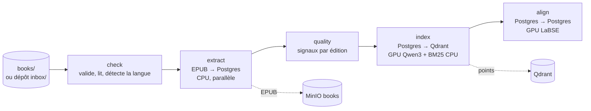
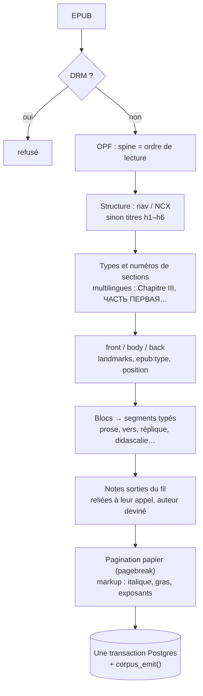
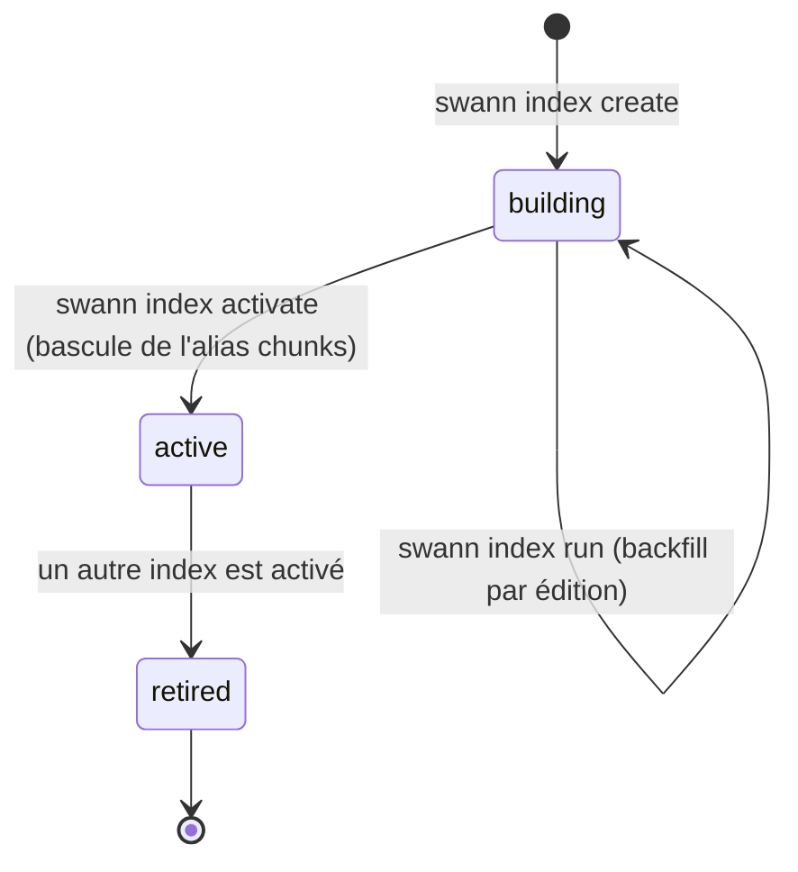

# Ingestion

Le pipeline (`ingest/`, Python, CLI `swann`) transforme des EPUB en corpus.
Il se déroule en étapes **indépendantes, relançables sans doublon**, qui
reprennent là où elles s'étaient arrêtées.



| Étape | Granularité | Matériel | Écrit |
| --- | --- | --- | --- |
| `extract` | 1× par livre | CPU, parallèle (`--workers N`) | œuvres, éditions, sections, segments, notes, pages ; EPUB dans MinIO |
| `quality` | 1× par édition | CPU | `edition_quality` |
| `index` | 1× par livre **et par modèle** | GPU (dense) + CPU (BM25) | `chunks`, points Qdrant, `edition_indexings` |
| `align` | 1× par **œuvre** (≥ 2 éditions) | GPU (LaBSE) | `work_units`, `segment_alignments`, `edition_alignments` |

## Ranger les livres

Deux voies d'entrée : le dossier `books/` (import en lot) ou le **dépôt**
depuis la [console](#console) (classement automatique).

```
books/
└── dostoievski-fiodor/
    └── crime-et-chatiment/
        ├── work.toml
        ├── ru.epub                  ← original
        ├── fr--markowicz.epub       ← <langue>--<traducteur>.epub
        └── en--garnett.epub
```

La fiche `work.toml` décrit l'œuvre (titre original, langue, année, auteurs,
courants, QID Wikidata) et chaque édition (fichier, langue, traducteurs,
éditeur, droits `access`). Depuis la console, **Postgres est la référence** :
`swann extract` crée ce qui manque mais ne réécrit plus une fiche existante
(`--overwrite-metadata` pour forcer).

`books/persons.toml` (facultatif) donne l'identité des personnes citées dans
les fiches, par nom exact : QID Wikidata, dates, nom de tri, graphies par
langue. `swann extract` reconnaît alors une personne à son QID et complète ses
champs vides (sans jamais écraser ce qui a été corrigé dans la console).

```toml
["Fiodor Dostoïevski"]
wikidata = "Q991"
birth_year = 1821
death_year = 1881
sort_name = "Dostoïevski, Fiodor"
names.ru = ["Фёдор Михайлович Достоевский"]
```

### Préparer un lot d'EPUB en vrac

`swann prepare SRC OUT` range un dossier d'EPUB à plat (Wikisource, Wolne
Lektury, Project Gutenberg, textos.info, Bibliothèque électronique du
Québec…) en `OUT/books/` prêt pour `swann extract` :

1. inventaire : OPF, page de licence, texte lu par le parseur de Swann
   (langue détectée, extraits) — mis en cache par sha256 dans
   `OUT/cache.sqlite`, comme les réponses Wikidata : la commande se relance ;
2. normalisation par source (rôles, noms « автор … (1867—1942) », auteur
   repris du nom de fichier quand l'OPF se trompe, tomes) ;
3. personnes rattachées à Wikidata (nom, initiales, dates, métier,
   notoriété) : un nom d'usage unique par personne, écrit dans
   `persons.toml` ;
4. œuvres : élément lié à la page Wikisource ou au livre Gutenberg, sinon
   titre parmi les œuvres de l'auteur dans Wikidata, sinon même auteur et
   même titre ; langue originale, édition originale, doublons ;
5. droits : `open` si la source déclare une licence libre ou le domaine
   public, ou si auteurs et traducteurs sont morts depuis plus de 70 ans ;
   sinon `excerpt`, motif noté dans la fiche ;
6. écriture par liens durs (aucune copie, sources intactes) ; textes
   officiels, illisibles, de langue incertaine et doublons en
   `OUT/quarantaine/` ; cas à relire dans `OUT/rapport/a-verifier.csv`.

```bash
swann prepare /mnt/livres /mnt/livres/swann
BOOKS_DIR=/mnt/livres/swann/books swann extract
```

## Extraction



- La licence Project Gutenberg est retirée ; les tables des matières
  aplaties de Gutenberg sont ré-imbriquées.
- Les pages ajoutées par les bibliothèques (dons et page éditoriale de Wolne
  Lektury, « À propos » de Wikisource, notices de textos.info) sont écartées.
- Un tableau de mise en page (poèmes de Wikisource) est lu ; un tableau de
  données est ignoré. Un XHTML mal formé est relu par le parseur HTML.
- « N.d.T. » → note du traducteur.
- Un texte **remplacé** (nouvel EPUB d'une édition existante) incrémente
  `editions.revision` et émet `edition.text_replaced` (voir
  [Révisions et ancres](#revisions)).
- Seul le **corps** (`matter = body`) est ensuite vectorisé.

## Découpage et indexation

Le découpeur `v1` produit des **fenêtres de segments entiers** :

| Paramètre | Valeur |
| --- | --- |
| cible | ~400 tokens |
| maximum | 512 tokens (un segment plus long reste seul) |
| chevauchement | ~60 tokens (derniers segments du chunk précédent) |
| minimum | 100 tokens (un dernier chunk trop petit est fusionné) |

Un chunk ne déborde jamais de sa section et n'inclut jamais de note.

Chaque chunk devient un point Qdrant avec deux vecteurs nommés :

- `dense` — **Qwen3-Embedding-0.6B** (1024 dimensions, cosinus), sur GPU ;
- `bm25` — vecteur creux calculé sur CPU (racinisation Snowball selon la
  langue, hachage 32 bits), l'IDF étant calculé par Qdrant.

Le payload porte de quoi filtrer sans retourner à Postgres : `work_id`,
`edition_id`, `language`, `is_original`, `access`, `author_ids`,
`movement_ids`, `first_published_year`, `section_kind`…

## Changer de modèle d'embedding



L'ancien index reste interrogeable jusqu'à la bascule, et un seul index est
`active` à la fois (changement fait dans une même transaction). L'API
détecte la bascule et recharge l'encodeur d'elle-même (vérification toutes
les 30 s).

## Commandes

```bash
swann prepare SRC OUT             # range un lot d'EPUB en vrac en OUT/books/
swann check [--dump DIR]          # valide books/, --dump écrit le texte extrait
swann extract [--workers N]       # EPUB → Postgres (+ MinIO)
swann index create                # nouvel index (EMBEDDING_MODEL, découpage v1)
swann index run <collection>      # vectorise les éditions pas encore indexées
swann index activate <collection> # bascule l'alias de recherche
swann index sync-payload          # recopie les champs modifiables dans Qdrant
swann align [--work auteur/oeuvre]
swann quality
swann worker                      # exécute la file de tâches
swann status
swann search "un meurtre" --mode theme|quote|words --lang fr --show en
```

Les exécutions de la CLI créent aussi une ligne `jobs` (`kind = cli`) : elles
apparaissent dans la console comme celles du worker.
